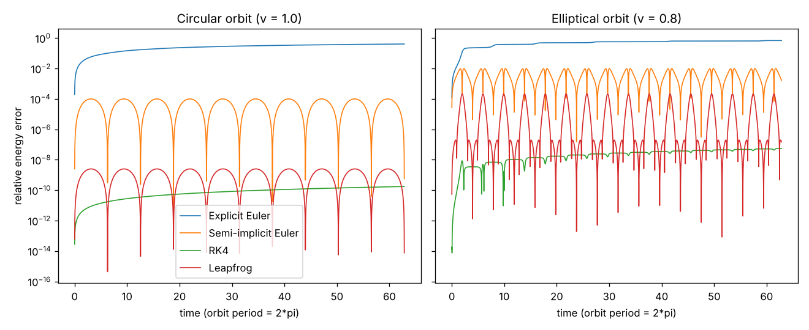
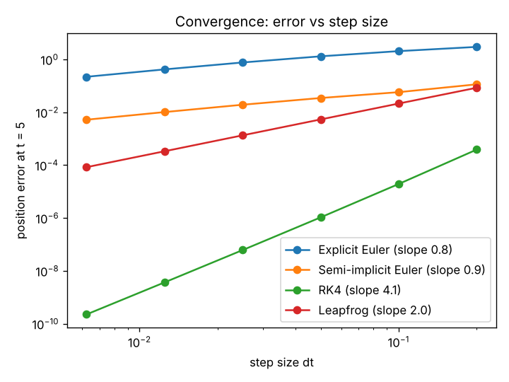
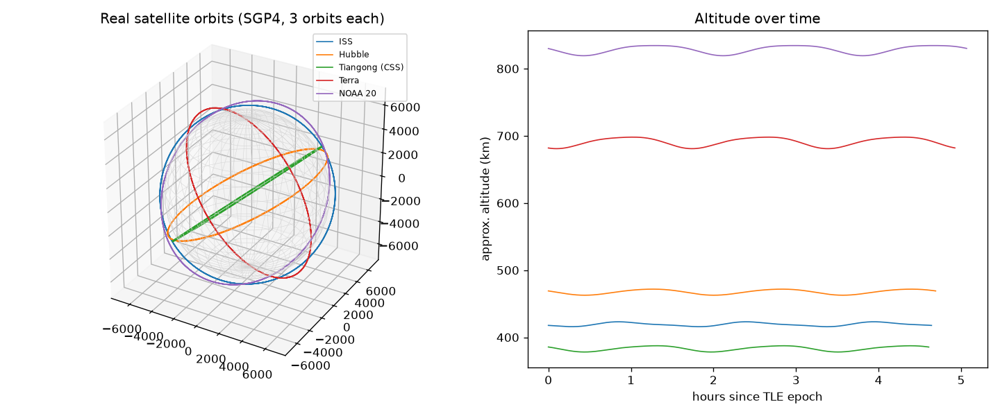
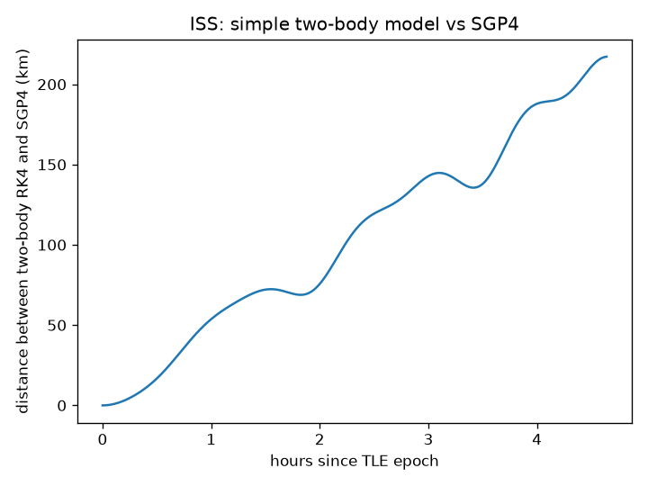

# Comparing Numerical Integrators for Orbital Motion

A small learning project: simulate a satellite orbiting a point mass (units where GM = 1,
circular orbit radius 1, speed 1, period 2π) with four integrators and check how well each
conserves energy and angular momentum over 10 orbits.

## Methods
- Explicit Euler (1st order)
- Semi-implicit Euler (1st order, symplectic)
- RK4 (4th order)
- Leapfrog / velocity Verlet (2nd order symplectic)

Each is also compared against a high-accuracy SciPy reference (`solve_ivp`, DOP853, rtol/atol 1e-12).

## Results (dt = 0.01, 10 orbits)



| Method | Circular: final energy error | Circular: max position diff vs SciPy | v = 0.8: max energy error |
|---|---|---|---|
| Explicit Euler | 4.1e-01 | 2.65 | 6.9e-01 |
| Semi-implicit Euler | 5.6e-10 (max 1.0e-04) | 1.98e-02 | 9.9e-03 |
| RK4 | 1.75e-10 | 2.26e-08 | 5.5e-08 |
| Leapfrog | 7.6e-15 (max 2.5e-09) | 2.10e-03 | 2.1e-04 |

What the runs show:
- Explicit Euler gains energy steadily and the orbit spirals outward. This is a property of the method, not a bug.
- RK4 is by far the most accurate here, but its energy error only grows (it is not conserved by design).
- Semi-implicit Euler and leapfrog keep energy error small and oscillating, and conserve angular momentum to rounding level, but their positions drift from the true orbit more than RK4's (phase error).
- These are 10-orbit runs at one step size; I have not tested long runs or other step sizes in this repo yet.

## Convergence test


Position error at t = 5 (circular orbit) vs step size, against the SciPy reference:

| Method | Expected order | Observed slope (dt 0.2 to 0.00625) |
|---|---|---|
| Explicit Euler | 1 | 0.76 (0.93 over the two smallest steps) |
| Semi-implicit Euler | 1 | 0.87 |
| RK4 | 4 | 4.14 |
| Leapfrog | 2 | 2.00 |

The Euler methods only reach their first-order slope at small steps. I ended at t = 5 on purpose: ending at exactly one full orbit made semi-implicit Euler look second-order because errors cancel there.

## Real satellites (SGP4)
`real_satellites.py` downloads current TLEs from CelesTrak for the ISS, Hubble, Tiangong, Terra and NOAA 20, propagates them with SGP4, and plots their orbits and altitudes. It also compares the ISS SGP4 path with a plain two-body RK4 integration started from the same state, to show how much real perturbations (Earth's oblateness, drag) change the orbit. Altitude is approximate (spherical Earth).



Run on 2026-10-24 with TLEs downloaded that day (3 orbits each, altitude is approximate):

| Satellite | Mean altitude (km) | Range (km) |
|---|---|---|
| ISS | 419.3 | 415.8 to 423.2 |
| Hubble | 467.5 | 462.7 to 471.7 |
| Tiangong (CSS) | 383.3 | 378.1 to 387.5 |
| Terra | 690.8 | 680.9 to 698.1 |
| NOAA 20 | 828.4 | 819.3 to 834.4 |



Started from the same state, a plain two-body RK4 path is 217 km away from the SGP4 path after 3 ISS orbits (about 4.6 hours). Two-body leaves out effects such as Earth's oblateness and drag; I have not separated how much each contributes.

TLEs are only accurate to roughly a kilometre or worse and degrade with age, so this project counts close approaches; it does not predict real collisions.

## How to run
```
pip install -r requirements.txt
python orbit_integrators_comparison.py   # four-method comparison -> energy_error_comparison.png
python convergence.py                    # convergence test -> convergence.png
python real_satellites.py                # needs internet (CelesTrak) -> real_satellites.png, iss_twobody_vs_sgp4.png
```

## Next steps
- Longer runs to see RK4's drift against leapfrog's bounded error.
- Count close approaches between LEO satellites by altitude using many TLEs.

## Author
Manan, Class 12, Delhi. A learning project; feedback welcome.
