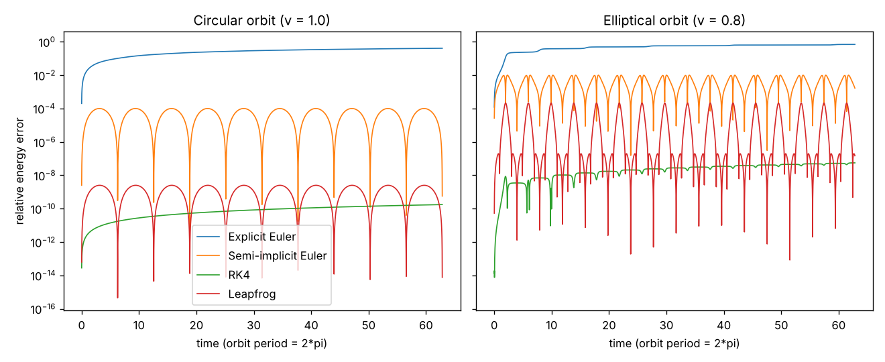
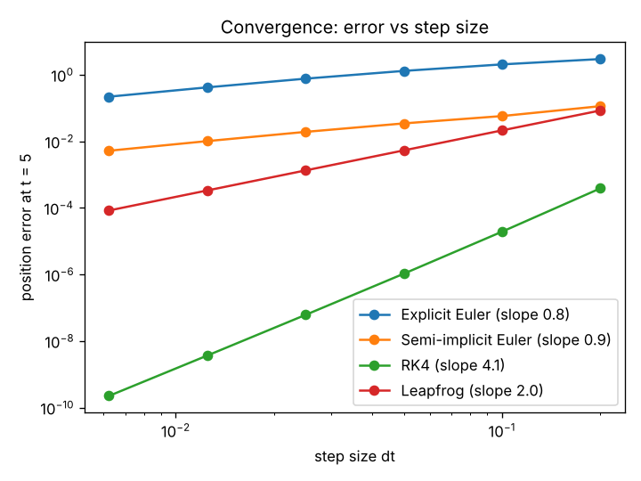
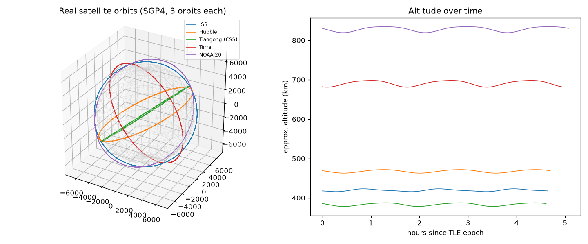
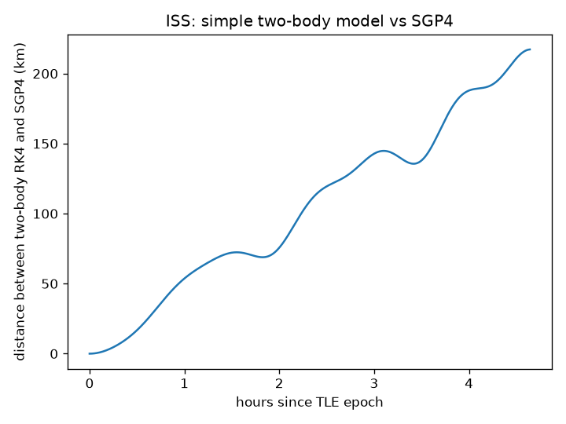
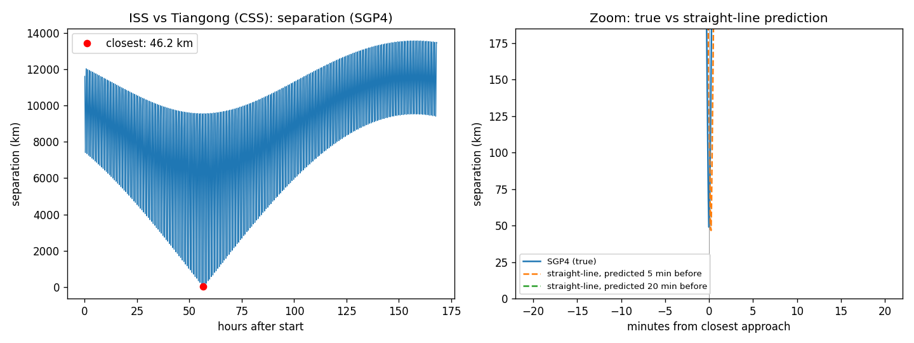
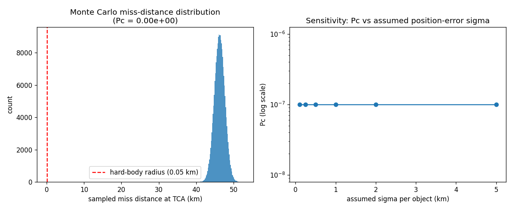

# Comparing Numerical Integrators for Orbital Motion

A small learning project: simulate a satellite orbiting a point mass (units where GM = 1,
circular orbit radius 1, speed 1, period 2π) with four integrators and check how well each
conserves energy and angular momentum over 10 orbits.

## Methods
- Explicit Euler (1st order)
- Semi-implicit Euler (1st order, symplectic)
- RK4 (4th order)
- Leapfrog / velocity Verlet (2nd order symplectic)

Each is also compared against a high-accuracy SciPy reference (`solve_ivp`, DOP853, rtol/atol 1e-12).

## Results (dt = 0.01, 10 orbits)



| Method | Circular: final energy error | Circular: max position diff vs SciPy | v = 0.8: max energy error |
|---|---|---|---|
| Explicit Euler | 4.1e-01 | 2.65 | 6.9e-01 |
| Semi-implicit Euler | 5.6e-10 (max 1.0e-04) | 1.98e-02 | 9.9e-03 |
| RK4 | 1.75e-10 | 2.26e-08 | 5.5e-08 |
| Leapfrog | 7.6e-15 (max 2.5e-09) | 2.10e-03 | 2.1e-04 |

What the runs show:
- Explicit Euler gains energy steadily and the orbit spirals outward. This is a property of the method, not a bug.
- RK4 is by far the most accurate here, but its energy error only grows (it is not conserved by design).
- Semi-implicit Euler and leapfrog keep energy error small and oscillating, and conserve angular momentum to rounding level, but their positions drift from the true orbit more than RK4's (phase error).
- These are 10-orbit runs at one step size; I have not tested long runs or other step sizes in this repo yet.

## Convergence test


Position error at t = 5 (circular orbit) vs step size, against the SciPy reference:

| Method | Expected order | Observed slope (dt 0.2 to 0.00625) |
|---|---|---|
| Explicit Euler | 1 | 0.76 (0.93 over the two smallest steps) |
| Semi-implicit Euler | 1 | 0.87 |
| RK4 | 4 | 4.14 |
| Leapfrog | 2 | 2.00 |

The Euler methods only reach their first-order slope at small steps. I ended at t = 5 on purpose: ending at exactly one full orbit made semi-implicit Euler look second-order because errors cancel there.

## Real satellites (SGP4)
`real_satellites.py` downloads current TLEs from CelesTrak for the ISS, Hubble, Tiangong, Terra and NOAA 20, propagates them with SGP4, and plots their orbits and altitudes. It also compares the ISS SGP4 path with a plain two-body RK4 integration started from the same state, to show how much real perturbations (Earth's oblateness, drag) change the orbit. Altitude is approximate (spherical Earth).



Run on 2026-10-24 with TLEs downloaded that day (3 orbits each, altitude is approximate):

| Satellite | Mean altitude (km) | Range (km) |
|---|---|---|
| ISS | 419.3 | 415.8 to 423.2 |
| Hubble | 467.5 | 462.7 to 471.7 |
| Tiangong (CSS) | 383.3 | 378.1 to 387.5 |
| Terra | 690.8 | 680.9 to 698.1 |
| NOAA 20 | 828.4 | 819.3 to 834.4 |



Started from the same state, a plain two-body RK4 path is 217 km away from the SGP4 path after 3 ISS orbits (about 4.6 hours). Two-body leaves out effects such as Earth's oblateness and drag; I have not separated how much each contributes.

TLEs are only accurate to roughly a kilometre or worse and degrade with age, so this project counts close approaches; it does not predict real collisions.

## Reading general perturbation (GP) data
`explore_gp.py` decodes every field in a TLE (epoch, inclination, RAAN, eccentricity, argument of perigee, mean anomaly, mean motion, BSTAR drag term) into plain units, and prints each satellite's data age. TLEs hold *mean* elements that only make sense together with SGP4 (the general-perturbation theory they were fitted with); this project only uses SGP4 to generate orbits from them, no separate propagator.

## Time and distance of closest approach (TCPA / DCPA)
`closest_approach.py` takes two satellites, finds the time and distance of their closest approach (TCA/DCA) over a chosen window using SGP4 only, and separately predicts the TCPA/DCPA from an earlier moment using straight-line (constant relative velocity) motion. It compares the prediction against the true SGP4 answer for several lead times, so you can see how the prediction degrades the further ahead it is made. This follows guidance from a researcher at IIIT Delhi's Space Systems Laboratory: SGP4 only for orbit generation, then closest approach relative to the predicted TCPA.



Run on 2026-11-15/16 with that day's TLEs, ISS vs Tiangong (CSS) over a 168-hour (7-day) window. A 24-hour window found no real encounter (both are actively maneuvered stations, so they don't drift close by accident); over 7 days SGP4 found a genuine close pass:

**Closest approach: 46.24 km, about 56.6 hours into the window.**

| Lead time before TCA | Predicted TCPA error | Predicted DCPA error |
|---|---|---|
| 60 s | 0.09 s | −0.12 km |
| 300 s | 12.1 s | −1.86 km |
| 600 s | 113.3 s | 0.37 km |
| 1200 s | 2897 s | 226.5 km |
| 1800 s | −3549 s (wrong-signed) | 161.5 km |

The straight-line approximation is solid within about 10 minutes of the real closest approach, then collapses fast beyond 20 minutes (error jumps over 20x between the 10 and 20 minute rows). I have not checked this pattern against a second, independent pair yet.

## Collision probability (Monte Carlo)
`monte_carlo_probability.py` estimates a collision probability at the nominal time of closest approach, the same basic idea as IIIT Delhi's OrCo platform (Chowdhury, Harsha, Gupta & Biswas, IPSC 2025): since a TLE carries no stated position uncertainty, it assumes a position-error standard deviation per object, samples many perturbed relative positions at TCA, and counts the fraction inside a combined hard-body radius. The sampling logic was checked against the closed-form non-central chi-squared distribution for a 3D Gaussian and matched to within Monte Carlo noise.



**The default `SIGMA_KM` (1 km) and `HARD_BODY_RADIUS_KM` (0.05 km) in the script are placeholders, not measured values**, pending real numbers from the lab. Run on the 46.24 km ISS/Tiangong approach above: **Pc = 0** (zero hits in 200,000 trials). At sigma = 1 km, 46 km is roughly 32 standard deviations away, so the true probability is far smaller than 200,000 trials can resolve — this is a correct result, not a failed run. The right-hand panel shows this honestly: sigmas with zero observed hits are marked as "below the smallest probability this many trials could detect," rather than plotted as a fake nonzero value.

## How to run
```
pip install -r requirements.txt
python orbit_integrators_comparison.py    # four-method comparison -> energy_error_comparison.png
python convergence.py                     # convergence test -> convergence.png
python real_satellites.py                 # needs internet (CelesTrak) -> real_satellites.png, iss_twobody_vs_sgp4.png
python explore_gp.py                      # decode the cached TLEs (run real_satellites.py first)
python closest_approach.py                # TCPA/DCPA for ISS vs Tiangong, 24h -> closest_approach.png
python monte_carlo_probability.py         # Monte Carlo Pc at TCA (placeholder inputs) -> monte_carlo_probability.png
```

## Next steps
- Run `closest_approach.py` and `monte_carlo_probability.py` on live TLE data and record real numbers here.
- Validate the TCPA/DCPA output against a known case (e.g. CelesTrak's SOCRATES list) or a value confirmed by the lab.
- Get realistic `SIGMA_KM` and `HARD_BODY_RADIUS_KM` values from the lab and rerun the probability estimate.
- Count close approaches between many LEO satellites by altitude shell, if that broader statistic is still wanted.

## Author
Manan, Class 12, Delhi. A learning project; feedback welcome.
