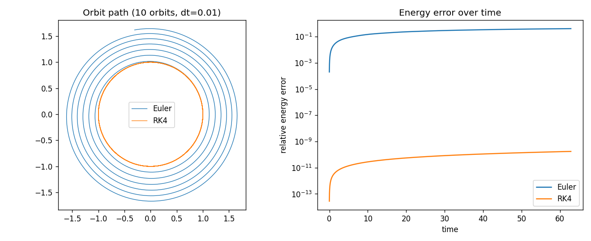

# Comparing Numerical Integrators for Orbital Motion

A small learning project: simulate a satellite orbiting a point mass (units where GM = 1,
circular orbit radius 1, speed 1, period 2π) with four integrators and check how well each
conserves energy and angular momentum over 10 orbits.

## Methods
- Explicit Euler (1st order)
- Semi-implicit Euler (1st order, symplectic)
- RK4 (4th order)
- Leapfrog / velocity Verlet (2nd order, symplectic)

Each is also compared against a high-accuracy SciPy reference (`solve_ivp`, DOP853, rtol/atol 1e-12).

## Results (dt = 0.01, 10 orbits)



| Method | Circular: final energy error | Circular: max position diff vs SciPy | v = 0.8: max energy error |
|---|---|---|---|
| Explicit Euler | 4.1e-01 | 2.65 | 6.9e-01 |
| Semi-implicit Euler | 5.6e-10 (max 1.0e-04) | 1.98e-02 | 9.9e-03 |
| RK4 | 1.75e-10 | 2.26e-08 | 5.5e-08 |
| Leapfrog | 7.6e-15 (max 2.5e-09) | 2.10e-03 | 2.1e-04 |

What the runs show:
- Explicit Euler gains energy steadily and the orbit spirals outward. This is a property of the method, not a bug.
- RK4 is by far the most accurate here, but its energy error only grows (it is not conserved by design).
- Semi-implicit Euler and leapfrog keep energy error small and oscillating, and conserve angular momentum to rounding level, but their positions drift from the true orbit more than RK4's (phase error).
- These are 10-orbit runs at one step size; I have not tested long runs or other step sizes in this repo yet.

## How to run
```
pip install numpy scipy matplotlib
python orbit_integrators_comparison.py
```
This prints the table values and saves `energy_error_comparison.png`.

## Next steps
- Error vs step size (convergence order) for each method.
- Longer runs to see RK4's drift against leapfrog's bounded error.
- Real satellite orbits from public TLE data (CelesTrak + sgp4).

## Author
Manan, Class 12, Delhi. A learning project; feedback welcome.
